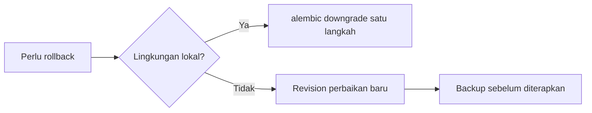

# Panduan Migration Database

**Status:** DRAFT

**Last Updated:** 2026-10-01

## Purpose

Menjelaskan cara menjalankan, membuat, meninjau, dan membatalkan migration Alembic, serta aturan seed data.

## Confirmed Information

- **CONFIRMED**: Migration dikelola dengan Alembic di `apps/api` (sumber: brief sesi 2026-10-01).
- **CONFIRMED**: Revision awal `0001_initial_schema` mendefinisikan 30 tabel (sumber: fact sheet bagian 6; status skema PROPOSED).
- **CONFIRMED**: Migration, seed, dan downgrade sudah divalidasi terhadap PostgreSQL sementara melalui `pgserver`; jalur Docker belum divalidasi di mesin pengembangan saat ini (sumber: implementasi scaffold sesi 2026-10-01).
- **CONFIRMED**: Runtime API belum memakai database (`DATA_BACKEND=simulated`, ADR-007).

## Perintah

| Tujuan | Perintah | Lokasi |
|---|---|---|
| Menjalankan PostgreSQL lokal | `pnpm db:up` | Root |
| Upgrade ke revision terbaru | `pnpm db:migrate` | Root |
| Memuat seed SIMULATED_DATA | `pnpm db:seed` | Root |
| Render SQL offline untuk review | `pnpm db:sql` | Root |
| Membuat revision baru | `uv run alembic revision -m "deskripsi singkat"` | `apps/api` |
| Validasi tanpa Docker | `pwsh scripts/validation/db-check-pgserver.ps1` | Root |

`pnpm db:migrate` dan `pnpm db:seed` memakai `DATABASE_URL` (lihat [environment-configuration.md](environment-configuration.md)).

## Membuat Revision Baru

1. Pastikan database lokal berada di head (`pnpm db:migrate`).
2. Dari folder `apps/api`, jalankan `uv run alembic revision -m "deskripsi singkat"`.
3. Tulis fungsi `upgrade()` dan `downgrade()` secara eksplisit. Downgrade harus membalik upgrade sepenuhnya.
4. Perbarui model SQLAlchemy yang terkait pada perubahan yang sama.
5. Jalankan `pnpm db:sql` dan tinjau SQL hasil render.
6. Jalankan upgrade, seed, dan downgrade terhadap database uji (Docker Compose atau skrip pgserver).
7. Perbarui [database-schema.md](../04-data/database-schema.md) dan catat di CHANGELOG.md.

## Aturan Review (PROPOSED)

- Satu revision untuk satu perubahan logis; nama revision menjelaskan tujuan.
- Kolom bisnis baru mengikuti kolom umum: `id`, `created_at`, `updated_at`, `created_by`, `updated_by`, `revision`, `status`, `classification_code`, `owner_team_id`, `owner_user_id`, `deleted_at`, `data_origin` (sumber: fact sheet bagian 6).
- Tidak ada kolom BLOB untuk isi file; simpan referensi, metadata, checksum SHA-256, versi, klasifikasi, dan lokasi provider (sumber: ADR-003).
- Penghapusan record bisnis memakai soft delete `deleted_at` (sumber: ADR-010).
- Trigger append-only pada `audit_logs` tidak boleh dilemahkan (sumber: ADR-010).
- Kolom vektor tetap tanpa tipe dimensi dan tanpa indeks ANN sampai model embedding disetujui (sumber: ADR-009, OQ-11).
- Tabel SUN Business (instrumen, lelang, transaksi, yield, settlement) tidak ditambahkan sebelum divalidasi (sumber: ADR-013).
- Perubahan yang menghapus kolom atau tabel berisi data memerlukan rencana migrasi data dan persetujuan sebelum diterapkan di luar lokal.

## Migration yang Sudah Diterapkan

- **PROPOSED**: Migration yang sudah diterapkan di lingkungan bersama mana pun tidak boleh diedit. Perbaikan dibuat sebagai revision baru.
- **PROPOSED**: Selama belum ada lingkungan bersama, `0001_initial_schema` masih dapat direvisi, tetapi setiap perubahan dicatat di CHANGELOG.md.

## Kebijakan Downgrade

- **PROPOSED**: Downgrade dipakai di lokal dan dalam validasi otomatis. Di lingkungan bersama, rollback dilakukan dengan revision perbaikan maju setelah backup (lihat [backup-and-restore.md](backup-and-restore.md)).
- **OPEN QUESTION**: Kebijakan rollback produksi bergantung pada hosting yang disetujui (OQ-07).

## Seed

- **CONFIRMED**: Seed memuat dataset `SIMULATED_DATA` yang sama dengan store simulasi runtime (sumber: ADR-007).
- **PROPOSED**: Seed hanya berisi data simulasi; `data_origin` bernilai `SIMULATED_DATA`. Data asli, data pribadi, dan angka SUN asli tidak boleh masuk seed.
- **PROPOSED**: Seed tidak dijalankan pada database yang berisi data `USER_ENTERED` atau `INTEGRATION`.

## Related Documents

- [database-schema.md](../04-data/database-schema.md)
- [simulated-data-policy.md](../04-data/simulated-data-policy.md)
- [integration-testing.md](../10-testing/integration-testing.md)
- [backup-and-restore.md](backup-and-restore.md)
