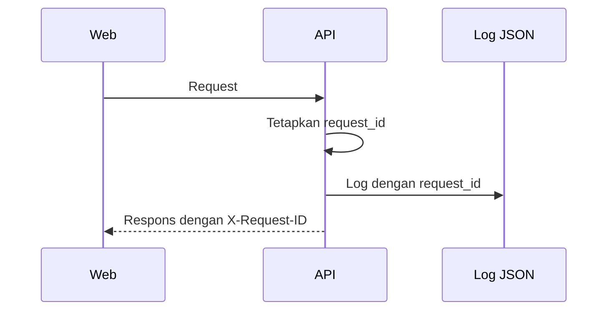

# Observability

**Status:** DRAFT

**Last Updated:** 2026-10-19

## Purpose

Menjelaskan log, korelasi request, health check, dan audit pada SUNOVATE, serta aturan apa yang tidak boleh dicatat.

## Confirmed Information

- **CONFIRMED**: Backend menulis log terstruktur format JSON yang memuat `request_id` (sumber: implementasi scaffold sesi 2026-10-01).
- **CONFIRMED**: Setiap respons API memuat header `X-Request-ID`; respons error memuat field `requestId` (sumber: implementasi scaffold sesi 2026-10-01).
- **CONFIRMED**: Endpoint health: `GET /api/v1/health` dan `GET /api/v1/health/database` (sumber: implementasi scaffold sesi 2026-10-01).
- **CONFIRMED**: Level log diatur oleh `LOG_LEVEL` (sumber: implementasi scaffold sesi 2026-10-01).
- **CONFIRMED**: Audit log adalah data bisnis yang bersifat append-only; di PostgreSQL ditegakkan oleh trigger (sumber: ADR-010).
- **CONFIRMED (implementasi)**: Kontrol API menyimpan counter agregat privat per proses; tidak ada endpoint metrik publik (ADR-019).
- **PROPOSED, IMPLEMENTED package**: Nginx demo mencatat request ID, alamat koneksi, method/path, status, ukuran respons, durasi, dan user-agent tanpa body atau header otorisasi. Paket belum dijalankan pada host kantor.

## Korelasi Request

- **PROPOSED**: Saat melaporkan masalah, sertakan nilai `X-Request-ID` atau `requestId` agar log dapat ditelusuri tanpa menyalin isi data.

## Health Check

| Endpoint | Fungsi | Catatan |
|---|---|---|
| `GET /api/v1/health` | Proses API hidup | Tidak bergantung pada database. `dataBackend` adalah backend yang benar-benar terpasang pada runtime (bukan nilai `DATA_BACKEND` di konfigurasi) |
| `GET /api/v1/health/database` | Koneksi ke PostgreSQL | Konektivitas saja; backend runtime terlihat di field `dataBackend` pada `GET /api/v1/health` (`simulated` default, `postgres` per ADR-015, PROPOSED) |

- **CONFIRMED (implementasi, PROPOSED ADR-015)**: Pada `DATA_BACKEND=postgres`, kegagalan database dicatat dengan `code` dan `sqlstate`: `DATABASE_UNAVAILABLE` (koneksi gagal, pool habis) berbeda dari `DATABASE_BUSY` (SQLSTATE 57014, 55P03, 40P01, 40001). Lihat [error-format.md](../07-api/error-format.md).
- **CONFIRMED (implementasi, PROPOSED ADR-015)**: Saat API dimatikan, lifespan FastAPI memanggil `DataBackend.close()`; backend PostgreSQL membuang engine dan pool koneksinya, backend simulasi tidak melakukan apa pun.
- **CONFIRMED**: Service `postgres` di Docker Compose memiliki healthcheck (sumber: implementasi scaffold sesi 2026-10-01).

## Audit Log dan Log Aplikasi

| Aspek | Audit log | Log aplikasi |
|---|---|---|
| Tujuan | Jejak aksi pengguna untuk akuntabilitas | Diagnosis teknis |
| Penyimpanan | Tabel `audit_logs` bila `DATA_BACKEND=postgres` (persisten, append-only); store simulasi in-memory bila `DATA_BACKEND=simulated` (default) | Output proses (stdout) |
| Sifat | Append-only | Dapat dirotasi |
| Pembaca | Role dengan `audit:read` lewat `GET /api/v1/audit-logs` | Pengembang atau administrator sistem |
| Contoh isi | Aksi `LOGIN`, `CREATE`, `UPDATE`, `SUBMIT`, `APPROVE`, `REJECT`, `ACCESS_DENIED`, `AI_QUERY`, `AI_FEEDBACK`, `VERSION_REGISTER` | Method, path, status, durasi, `request_id` |

- **PROPOSED**: Log aplikasi tidak menggantikan audit log; keputusan akuntabilitas selalu merujuk audit log.

## Yang Tidak Boleh Dicatat

- **PROPOSED**: Token, header otorisasi, cookie, `DEV_AUTH_SECRET`, password, dan connection string berkredensial.
- **PROPOSED**: Isi dokumen, isi chunk, dan teks lengkap jawaban Hermes di log aplikasi.
- **PROPOSED**: Data pribadi dan data keuangan.
- **CONFIRMED (implementasi, PROPOSED ADR-015)**: Error tak tertangani dicatat tanpa pesan exception dan tanpa rantai penyebabnya. Log hanya memuat `errorType`, `sqlstate` (bila error database), `stack` (daftar `berkas:baris fungsi`), dan `requestId`. Pesan driver PostgreSQL (mis. `DETAIL: Key (kolom)=(nilai)`), teks SQL, dan parameter terikat tidak masuk log. Teruji di `apps/api/tests/test_runtime_hardening.py`.
- **PROPOSED**: Stack trace tidak dikirim ke klien; respons `INTERNAL_ERROR` hanya memuat `code`, `message`, dan `requestId`.
- **OPEN QUESTION**: Apakah teks pertanyaan Hermes boleh disimpan di audit dan berapa lama (OQ-13).

## Level Log (PROPOSED)

| Level | Pemakaian |
|---|---|
| `DEBUG` | Hanya lokal; tetap tanpa rahasia dan isi dokumen |
| `INFO` | Default; request dan peristiwa siklus hidup aplikasi |
| `WARNING` | Penolakan akses berulang, validasi gagal, provider nonaktif dipanggil |
| `ERROR` | Error tidak tertangani dengan `request_id` |

## Pengembangan Lanjutan (OPEN QUESTION)

- Metrik (latensi, tingkat error, jumlah query Hermes, rasio `INSUFFICIENT_EVIDENCE`) dan alatnya.
- Distributed tracing.
- Agregasi dan retensi log terpusat.
- Alerting dan penanggung jawabnya.

Semua butir di atas bergantung pada hosting yang disetujui (OQ-07) dan tidak ditambahkan tanpa kebutuhan yang divalidasi.

Probe load lokal menulis ringkasan ke terminal atau berkas yang dipilih operator: jumlah request, status, error rate, throughput, serta p50/p95/p99. Probe tidak mengirim kredensial maupun data bisnis dan tidak mengukur CPU/RAM/disk host; metrik host tetap harus dicatat oleh administrator saat uji sebenarnya.

## Related Documents

- [audit-logging.md](../06-security/audit-logging.md)
- [error-format.md](../07-api/error-format.md)
- [troubleshooting.md](troubleshooting.md)
