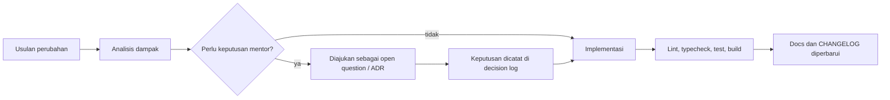

# Manajemen Perubahan

**Status:** PROPOSED
**Last Updated:** 2026-10-02

## Purpose

Dokumen ini mengatur cara perubahan cakupan, arsitektur, skema data, permission, dan dokumentasi diusulkan, ditinjau, dan dicatat, agar setiap keputusan dapat ditelusuri dan diserahterimakan.

## Confirmed Information

- **CONFIRMED**: Arsitektur modular monolith dengan FastAPI/SQLAlchemy/Alembic dan PostgreSQL; teknologi tambahan seperti Turborepo, Kubernetes, microservices, Redis, dan message broker tidak diizinkan tanpa kebutuhan tervalidasi (sumber: brief sesi 2026-10-01).
- **CONFIRMED**: Perubahan dijaga minimal; dependensi baru memerlukan kebutuhan konkret (sumber: AGENTS.md).

## Kategori Perubahan

| Kategori | Contoh | Peninjau usulan | Catatan wajib | Status |
|---|---|---|---|---|
| Cakupan | Menambah tim, fitur, atau integrasi | Mentor / Product Owner | Decision log, [mvp-scope](../01-product/mvp-scope.md) | PROPOSED |
| Arsitektur | Komponen baru, dependensi baru, provider baru | Mentor, pengembang | ADR di [architecture-decisions](../03-architecture/architecture-decisions.md), decision log | PROPOSED |
| Skema data | Tabel, kolom, constraint, enumerasi | Pengembang, ditinjau mentor bila menyentuh data bisnis | Revisi Alembic baru, [database-schema](../04-data/database-schema.md) | PROPOSED |
| Permission dan klasifikasi | Matriks role, aturan scope, ceiling Hermes | Mentor, security/compliance reviewer | [permission-matrix](../06-security/permission-matrix.md), uji otorisasi | PROPOSED |
| Aturan bisnis | Menambah atau mengubah BR-xx | Mentor | [business-rules](../02-business/business-rules.md) | PROPOSED |
| Dokumentasi | Koreksi, penambahan bagian | Pengembang | `Last Updated`, CHANGELOG bila material | PROPOSED |

## Alur Perubahan

## Ketentuan per Jenis Artefak

### Decision Log dan ADR

- **PROPOSED**: Setiap keputusan yang mengubah arsitektur, batas sistem, atau kebijakan data dicatat di [decision-log](decision-log.md) dengan ID baru; rincian teknis di [architecture-decisions](../03-architecture/architecture-decisions.md).
- **PROPOSED**: Keputusan tidak dihapus. Keputusan yang diganti diberi status "Digantikan oleh ADR-xxx".
- **PROPOSED**: Status keputusan berubah dari PROPOSED ke CONFIRMED hanya dengan sumber yang jelas (misalnya jawaban mentor bertanggal).

### Migrasi Database

- **PROPOSED**: Perubahan skema selalu melalui revisi Alembic baru; revisi yang sudah dibagikan tidak diedit.
- **PROPOSED**: Setiap revisi memiliki `downgrade` dan divalidasi dengan `pnpm db:migrate` atau `pnpm db:check` (migrate, seed, downgrade).
- **PROPOSED**: Seed diperbarui bersama skema dan tetap berlabel `SIMULATED_DATA`.
- **PROPOSED**: Trigger append-only `audit_logs` tidak boleh dilemahkan oleh migrasi.
- Panduan: [migration-guide](../11-operations/migration-guide.md).

### Permission

- **PROPOSED**: Perubahan matriks permission disertai uji yang membuktikan akses diizinkan dan ditolak sesuai matriks baru.
- **PROPOSED**: Perubahan yang memperluas akses (role, `scope:all_teams`, ceiling klasifikasi) diperlakukan berisiko tinggi dan memerlukan keputusan tercatat.

### Integrasi

- **CONFIRMED**: Integrasi produksi tetap nonaktif sampai divalidasi (sumber: AGENTS.md).
- **PROPOSED**: Aktivasi integrasi mengikuti [integration-readiness-checklist](../08-integrations/integration-readiness-checklist.md).

## Versi Dokumentasi

- **PROPOSED**: Setiap dokumen memuat `Status` dan `Last Updated`. Tanggal diperbarui setiap perubahan isi.
- **PROPOSED**: Status dokumen: `DRAFT` (sedang ditulis), `PROPOSED` (siap ditinjau), `NEEDS MENTOR VALIDATION` (bergantung pada konfirmasi mentor), `CONFIRMED` (divalidasi dengan sumber).
- **PROPOSED**: Riwayat dokumen mengikuti riwayat Git. Perubahan material juga dicatat di `CHANGELOG.md`.
- **CONFIRMED**: Dokumen lama diarsipkan ke `docs/_archive/legacy-docs-v0/`, tidak dihapus (sumber: ADR-012).
- **PROPOSED**: Tautan relatif antar-dokumen diperiksa setiap kali file dipindah atau diganti nama.

## Rilis dan Tag

- **PROPOSED (2026-10-28):** Setiap rilis memakai tag git beranotasi `vX.Y.Z` pada commit `main` yang sudah memuat kenaikan nomor versi (`package.json`, `apps/api/pyproject.toml`, `sunovate_api/__init__.py`) dan entri `CHANGELOG.md` bagian versi tersebut.
- Tag tidak pernah dipindahkan atau dihapus setelah di-push. Kesalahan diperbaiki dengan rilis berikutnya.
- Selama SUNOVATE belum siap produksi, setiap GitHub Release ditandai **pre-release** dan menyebut bahwa seluruh data adalah `SIMULATED_DATA`.
- Catatan rilis berbahasa Indonesia yang mudah dibaca mentor disimpan di `docs/13-handover/releases/vX.Y.Z.md` dan dipakai sebagai isi GitHub Release; rincian teknis tetap di `CHANGELOG.md`.
- Perubahan setelah rilis terakhir dicatat sebagai entri bertanggal di `CHANGELOG.md` sampai rilis berikutnya.

| Tag | Commit | Tanggal | Catatan |
|---|---|---|---|
| `v0.1.0` | `357df94` | 2026-10-02 | [v0.1.0](../13-handover/releases/v0.1.0.md) |
| `v0.2.0` | `8d63d54` | 2026-10-27 | [v0.2.0](../13-handover/releases/v0.2.0.md) |

## CHANGELOG

- **PROPOSED**: Entri CHANGELOG mencatat perubahan yang terlihat oleh pengguna, perubahan skema, perubahan permission, dan keputusan arsitektur, dengan rujukan ID keputusan atau aturan.

## Acceptance Criteria

- Setiap perubahan skema memiliki revisi Alembic dan pembaruan dokumentasi skema.
- Setiap perubahan permission memiliki uji otorisasi.
- Setiap keputusan baru memiliki entri di decision log.

## Related Documents

- [decision-log](decision-log.md)
- [risk-register](risk-register.md)
- [architecture-decisions](../03-architecture/architecture-decisions.md)
- [migration-guide](../11-operations/migration-guide.md)
- [developer-handover](../13-handover/developer-handover.md)
