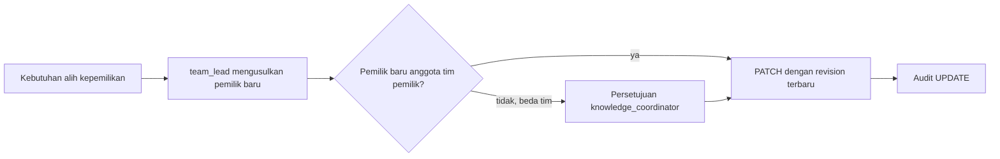

# Kepemilikan Dokumen dan Knowledge

**Status:** PROPOSED
**Last Updated:** 2026-10-02

## Purpose

Dokumen ini mengusulkan model kepemilikan untuk `knowledge_entries` dan `document_references`, pembagian tanggung jawab per role sistem, prosedur pengalihan kepemilikan, dan penanganan dokumen tanpa pemilik aktif.

## Confirmed Information

- **CONFIRMED**: Setiap tim berperan sebagai knowledge owner dan process owner (sumber: brief sesi 2026-10-01).
- **CONFIRMED**: File tetap menjadi referensi eksternal; SUNOVATE tidak menjadi penyimpan file utama (sumber: brief sesi 2026-10-01; ADR-003).
- **CONFIRMED (knowledge owner, deck v1_ slide 24)**: Knowledge owner dan reviewer pada masing-masing tim adalah ketua tim dan PIC yang ditunjuk (OQ-09, DEC-20261002-07). Penunjukan orang tidak dicatat di dokumentasi.
- **CONFIRMED (knowledge owner, deck v1_ slide 24)**: Yang dapat mengubah data atau mengunggah adalah ketua tim, kasubdit PMP, Kasi MP, dan PIC yang ditunjuk (OQ-05, DEC-20261002-03). Istilah "kasubdit PMP" dan "Kasi MP" dipakai apa adanya dari jawaban; dokumentasi ini tidak menguraikan singkatannya atau menetapkan kewenangan jabatan tersebut.
- **OPEN QUESTION (OQ-24)**: Pengakuan mentor atas jawaban di atas belum ada.
- **OPEN QUESTION (OQ-25)**: Pemetaan jabatan dan peran yang disebut knowledge owner ke role sistem.

## Pemetaan ke Role Sistem (PROPOSED)

Pemetaan berikut adalah usulan pengembang dan belum diimplementasikan.

| Yang disebut knowledge owner | Role sistem terdekat (PROPOSED) | Catatan |
|---|---|---|
| Ketua tim (knowledge owner dan reviewer tim) | `team_lead` | `team_lead` sudah memiliki izin ubah dan review pada matriks saat ini |
| PIC yang ditunjuk (knowledge owner dan reviewer tim) | `knowledge_owner` | `owner_user_id` pada record |
| Kasubdit PMP, Kasi MP | `knowledge_coordinator` (lintas tim) | Padanan jabatan ke role perlu konfirmasi; kepanjangan PMP tidak dijelaskan di deck |
| Staf biasa | `staff` | Pada jawaban OQ-05 tidak termasuk yang dapat mengubah/mengunggah; lihat [permission-matrix](../06-security/permission-matrix.md) |

## Model Kepemilikan

| Atribut | Makna | Status |
|---|---|---|
| `owner_team_id` | Tim yang bertanggung jawab atas isi dan lingkup akses record | PROPOSED |
| `owner_user_id` | Pengguna penanggung jawab harian dari tim pemilik | PROPOSED |
| `created_by`, `updated_by` | Jejak siapa yang membuat dan mengubah; bukan penanda kepemilikan | PROPOSED |
| `classification_code` | Ditetapkan pemilik, diperiksa reviewer | PROPOSED |
| `sharing_scope` | `TEAM` atau `DIRECTORATE`; ditetapkan pemilik | PROPOSED |

- **PROPOSED**: Kepemilikan melekat pada tim, bukan individu. `owner_user_id` dapat berganti tanpa mengubah tim pemilik.
- **PROPOSED**: `owner_user_id` harus anggota aktif tim pemilik (`team_memberships`).
- **PROPOSED**: Kepemilikan file di sistem sumber (misalnya SharePoint) tidak diatur SUNOVATE. Hubungan keduanya mengikuti OQ-06.

## Pembagian Tanggung Jawab (RACI)

R = Responsible, A = Accountable, C = Consulted, I = Informed. Seluruh tabel PROPOSED dan berbasis role pengembangan, bukan jabatan.

| Aktivitas | knowledge_owner | team_lead | reviewer | knowledge_coordinator | system_admin | auditor |
|---|---|---|---|---|---|---|
| Mendaftarkan knowledge dan referensi dokumen | R | A | I | I | | |
| Menetapkan klasifikasi dan `sharing_scope` | R | A | C | C | | |
| Meninjau isi sebelum publikasi | C | R | R | C | | |
| Memutuskan publikasi | I | C | C | A | | I |
| Mendaftarkan versi baru | R | A | I | I | | |
| Menangani isu kualitas data | R | A | | C | | I |
| Mengarsipkan atau menandai `SUPERSEDED` | C | C | | R/A | | I |
| Mengalihkan kepemilikan | C | R | | A | C | I |
| Mengelola akun dan role | | | | | R/A | I |
| Meninjau jejak audit | | | | | | R/A |

- **PROPOSED**: Kolom `knowledge_owner` dan `team_lead` pada tabel RACI di atas diisi oleh PIC dan ketua tim sesuai jawaban OQ-09; ini tidak mengubah tanda PROPOSED pada tabel.
- **OPEN QUESTION (OQ-12)**: Pemegang "A" untuk publikasi masih usulan; jawaban OQ-05 dan OQ-09 menyebut peran yang mengubah/mengunggah dan meninjau, bukan yang memutuskan publikasi; matriks permission saat ini hanya memberi `knowledge:publish` kepada `knowledge_coordinator`.
- **PROPOSED**: `system_admin` tidak memiliki `knowledge:create`/`update` dan tidak berperan atas isi.

## Pengalihan Kepemilikan

- **PROPOSED**: Alih pemilik dalam tim yang sama dilakukan melalui pembaruan record dengan `revision` terbaru dan permission `knowledge:update` atau `document:update`.
- **PROPOSED**: Alih ke tim lain mengubah lingkup akses; perlu tinjauan klasifikasi dan `sharing_scope`.
- **OPEN QUESTION**: Tipe approval khusus alih kepemilikan belum ada. Tipe yang tersedia: `KNOWLEDGE_PUBLICATION`, `HERMES_WRITE_ACTION`, `DOCUMENT_VERSION`, `ACCESS_EXCEPTION`. Penambahan tipe baru mengikuti [change-management](change-management.md).
- **PROPOSED**: Endpoint khusus pengalihan kepemilikan belum ada di scaffold.

## Dokumen Tanpa Pemilik Aktif

Record dianggap tanpa pemilik aktif bila `owner_user_id` tidak lagi aktif atau bukan anggota tim pemilik, atau tim pemilik tidak lagi berada dalam cakupan.

- **PROPOSED**: Kondisi ini dideteksi sebagai `data_quality_issues` dan terlihat oleh `knowledge_coordinator` (`data_quality:read`).
- **PROPOSED**: Selama belum ada pemilik baru, record `PUBLISHED` tetap dapat dicari, tetapi tidak dapat diajukan perubahan oleh pengguna tanpa kewenangan.
- **PROPOSED**: `team_lead` tim pemilik menunjuk pemilik baru; bila tim tidak lagi ada, `knowledge_coordinator` menetapkan tindak lanjut (alih tim, `ARCHIVED`, atau tetap dengan catatan).
- **OPEN QUESTION (OQ-02)**: Penanganan record bila daftar tim berubah.
- **OPEN QUESTION (OQ-13)**: Retensi record yang diarsipkan.

## Acceptance Criteria

- Setiap knowledge entry dan document reference memiliki `owner_team_id` dan `owner_user_id`.
- Perubahan pemilik tercatat di audit dengan nilai sebelum dan sesudah.
- Record tanpa pemilik aktif muncul pada daftar isu kualitas data.

## Related Documents

- [team-work-scope](../02-business/team-work-scope.md)
- [document-lifecycle](../02-business/document-lifecycle.md)
- [knowledge-governance](knowledge-governance.md)
- [permission-matrix](../06-security/permission-matrix.md)
- [data-quality](../04-data/data-quality.md)
