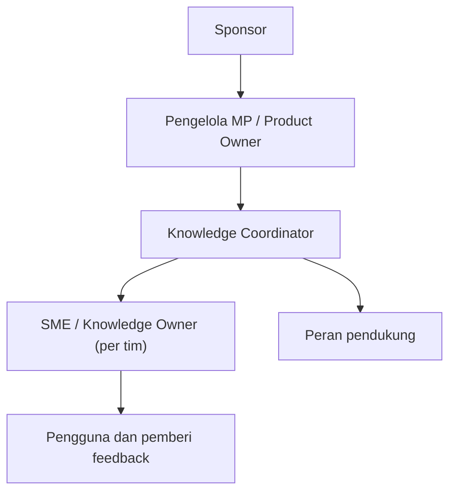

# Tata Kelola Knowledge

**Status:** PROPOSED
**Last Updated:** 2026-10-01

## Purpose

Dokumen ini mengusulkan model tata kelola knowledge SUNOVATE: peran tata kelola, pemetaannya ke role sistem, standar kualitas metadata, siklus tinjauan, dan ukuran keberhasilan. Dokumen ini tidak menetapkan jabatan atau kewenangan pegawai Dit. SUN.

## Confirmed Information

- **CONFIRMED**: Tujuan SUNOVATE mencakup menjaga institutional memory Dit. SUN (sumber: brief sesi 2026-10-01).
- **CONFIRMED**: Setiap tim berperan sebagai knowledge owner, process owner, dan document reviewer (sumber: brief sesi 2026-10-01).
- **CONFIRMED (status usulan)**: Proposal v2.4 slide 18 mengusulkan peran tata kelola; seluruh isinya PROPOSED sampai divalidasi mentor.

## Model Tata Kelola

## Peran Tata Kelola

| Peran (Proposal slide 18) | Tanggung jawab usulan | Role sistem terdekat | Status |
|---|---|---|---|
| Sponsor (Direktur SUN atau pejabat yang ditetapkan) | Arah dan prioritas | Tidak ada role sistem | PROPOSED |
| Pengelola MP / Product Owner | Prioritas backlog dan penerimaan fitur | Tidak ada role sistem | PROPOSED |
| Knowledge Coordinator | Konsistensi taksonomi, metadata, publikasi, arsip | `knowledge_coordinator` | PROPOSED |
| SME / Knowledge Owner | Kebenaran isi knowledge timnya | `knowledge_owner`, `team_lead` | PROPOSED |
| Administrator sistem | Pengguna, role, konfigurasi | `system_admin` | PROPOSED |
| Data steward | Kualitas data dan metadata | `knowledge_coordinator` (`data_quality:manage`) | PROPOSED |
| Security/compliance reviewer | Tinjauan akses dan audit | `auditor` | PROPOSED |
| Pengelola integrasi | Kesiapan integrasi eksternal | Tidak ada role sistem; integrasi nonaktif | PROPOSED |
| Pengguna / pemberi feedback | Memakai knowledge dan memberi umpan balik | `staff`, `reviewer`, `read_only` (`hermes:feedback`) | PROPOSED |

- **OPEN QUESTION (OQ-09)**: Siapa yang ditunjuk sebagai knowledge owner dan reviewer di setiap tim.
- **OPEN QUESTION (OQ-12)**: Siapa yang berwenang memutuskan publikasi.
- **OPEN QUESTION**: Apakah administrator sistem boleh membaca isi knowledge.

## Standar Kualitas Metadata

Metadata minimum untuk setiap knowledge entry sebelum diajukan review (PROPOSED):

| Field | Ketentuan |
|---|---|
| Judul | Deskriptif, tanpa singkatan yang tidak dijelaskan |
| Tipe knowledge | Salah satu nilai enumerasi (`REGULATION`, `SOP`, `PLAYBOOK`, dan seterusnya) |
| `owner_team_id` | Wajib; satu tim pemilik |
| `owner_user_id` | Wajib; pengguna aktif dari tim pemilik |
| `classification_code` | Wajib; `PUBLIC`, `INTERNAL`, `RESTRICTED`, atau `CONFIDENTIAL` |
| `sharing_scope` | `TEAM` atau `DIRECTORATE` |
| Ringkasan | Menjelaskan isi dan kegunaan |
| Tag | Minimal satu, dari kosakata yang disepakati |
| Referensi dokumen | Bila ada file, `document_references` terkait dengan checksum |
| Relasi regulasi | Untuk tipe `REGULATION`, relasi diisi hanya bila didukung teks peraturan |

Rincian field: [metadata-schema](../04-data/metadata-schema.md). Kontrol otomatis dan isu kualitas: [data-quality](../04-data/data-quality.md).

- **PROPOSED**: Reviewer memeriksa kesesuaian klasifikasi, kelengkapan metadata, ketiadaan data pribadi atau rahasia yang tidak perlu, serta ketiadaan teks berpola instruksi kepada AI.
- **PROPOSED**: Kekurangan metadata pada knowledge `PUBLISHED` dicatat sebagai `data_quality_issues` dan ditangani pemilik.

## Siklus Tinjauan

- **OPEN QUESTION**: Frekuensi tinjauan berkala knowledge `PUBLISHED` (misalnya per jenis knowledge) belum ditetapkan.
- **PROPOSED**: Tinjauan dipicu juga oleh peristiwa: regulasi baru yang mengubah atau mencabut, feedback negatif Hermes berulang, perubahan proses tim, atau temuan kualitas data.
- **PROPOSED**: Hasil tinjauan berupa tetap berlaku, versi baru, `SUPERSEDED`, atau `ARCHIVED`.

## Ukuran Keberhasilan

Dimensi dari Proposal v2.4 slide 23 (PROPOSED). Target angka belum ditetapkan dan menjadi OPEN QUESTION.

| Dimensi | Indikator usulan | Sumber data sistem |
|---|---|---|
| Retrieval | Proporsi pertanyaan uji yang menemukan chunk relevan | `tests/rag-evaluation` |
| Citation | Proporsi jawaban dengan sitasi valid | `ai_citations`, hasil CitationValidator |
| Access control | Nol kebocoran pada skenario akses tanpa izin | Uji keamanan, audit `ACCESS_DENIED` |
| Traceability | Setiap perubahan status knowledge memiliki entri audit | `audit_logs` |
| Adoption | Pengguna aktif dan query per tim pada UAT | `audit_logs` (`LOGIN`, `AI_QUERY`) |
| Quality | Jumlah isu kualitas terbuka dan feedback negatif | `data_quality_issues`, `ai_feedback` |

## Risks

- R-01 Asumsi proses bisnis tanpa validasi.
- R-09 Klasifikasi tidak sesuai skema resmi.
- R-11 Kualitas metadata rendah.

## Related Documents

- [knowledge-lifecycle](../02-business/knowledge-lifecycle.md)
- [document-ownership](document-ownership.md)
- [review-and-approval](review-and-approval.md)
- [stakeholder-map](../00-project/stakeholder-map.md)
- [rag-evaluation](../05-ai-rag/rag-evaluation.md)
