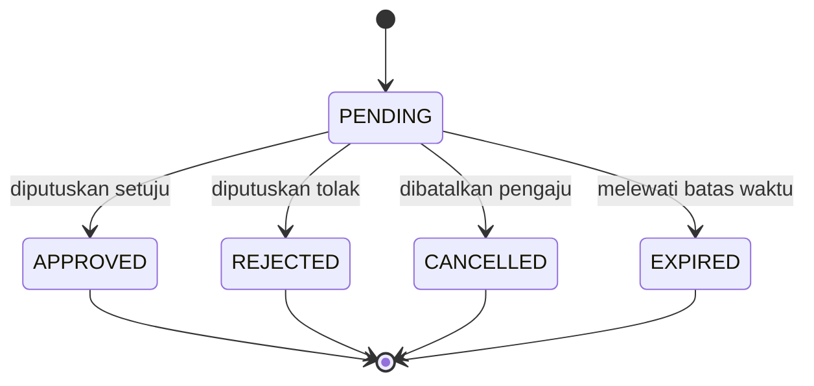
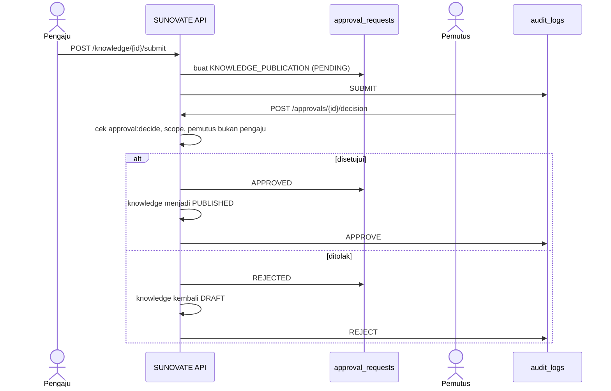
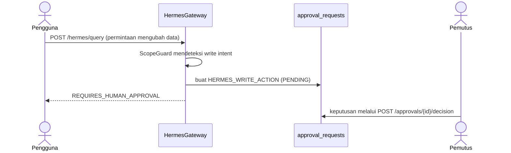

# Review dan Approval

**Status:** PROPOSED
**Last Updated:** 2026-10-06

## Purpose

Dokumen ini menjelaskan mekanisme `approval_requests` di SUNOVATE: tipe, status, alur publikasi knowledge, alur aksi tulis Hermes, pemisahan tugas, kedaluwarsa, dan audit. Dokumen ini tidak menetapkan rantai persetujuan organisasi; pemutus resmi adalah OQ-12.

## Confirmed Information

- **CONFIRMED**: SUNOVATE tidak memberikan akses dokumen tanpa otorisasi dan tidak mengambil keputusan keuangan (sumber: brief sesi 2026-10-01).
- **CONFIRMED**: Hermes tidak mengakses database secara langsung (sumber: brief sesi 2026-10-01; ADR-004).

## Tipe Approval

| Tipe | Kegunaan | Status |
|---|---|---|
| `KNOWLEDGE_PUBLICATION` | Satu-satunya jalur knowledge menjadi `PUBLISHED` | PROPOSED |
| `HERMES_WRITE_ACTION` | Permintaan aksi tulis yang terdeteksi dari percakapan Hermes; tidak pernah dieksekusi otomatis | PROPOSED |
| `DOCUMENT_VERSION` | Persetujuan versi dokumen bila diperlukan | PROPOSED; cakupan wajibnya OPEN QUESTION |
| `ACCESS_EXCEPTION` | Pengecualian akses di luar lingkup normal | PROPOSED; kebijakannya OPEN QUESTION (OQ-14) |

## Status Approval

- **PROPOSED**: Hanya `PENDING` yang dapat diputuskan. Status akhir tidak dapat diubah; pengajuan ulang membuat record baru.

## Alur Publikasi Knowledge

- **PROPOSED (diimplementasikan di scaffold)**: `POST /knowledge/{id}/submit` memindahkan knowledge DRAFT ke `IN_REVIEW` dan sekaligus membuat approval `KNOWLEDGE_PUBLICATION` berstatus PENDING. APPROVE memindahkan knowledge ke `PUBLISHED`; REJECT mengembalikannya ke `DRAFT`. APPROVE publikasi memerlukan `knowledge:publish` di samping `approval:decide`, sehingga reviewer hanya dapat REJECT.
- **PROPOSED**: Keputusan memerlukan `approval:decide` serta lingkup tim dan klasifikasi yang mencakup record terkait.
- **PROPOSED**: Penolakan sebaiknya disertai alasan agar pemilik dapat memperbaiki.

## Alur Aksi Tulis Hermes

- **PROPOSED**: Hermes tidak pernah mengeksekusi aksi tulis, termasuk setelah approval disetujui. Persetujuan hanya mencatat keputusan; eksekusi aksi oleh manusia melalui fitur aplikasi yang sesuai.
- **OPEN QUESTION**: Apakah approval `HERMES_WRITE_ACTION` yang disetujui kelak boleh memicu eksekusi otomatis. Sampai diputuskan, jawabannya tidak.
- Detail: [human-approval](../05-ai-rag/human-approval.md).

## Pemisahan Tugas

- **PROPOSED**: Pemutus tidak boleh sama dengan pengaju. API menolak keputusan atas pengajuan sendiri, termasuk bagi role dengan `scope:all_teams`.
- **PROPOSED**: Role dengan `approval:decide`: `knowledge_coordinator`, `team_lead`, `reviewer`. Publikasi knowledge saat ini memerlukan `knowledge:publish`, yang hanya dimiliki `knowledge_coordinator`.
- **OPEN QUESTION (OQ-12)**: Apakah `team_lead` boleh mempublikasikan, dan siapa pemutus resmi.
- **PROPOSED**: `auditor` dan `system_admin` tidak memutuskan approval.

## Pelaku Menurut Jawaban Knowledge Owner

- **CONFIRMED (knowledge owner, deck v1_ slide 24)**: Knowledge owner dan reviewer pada setiap tim adalah ketua tim dan PIC yang ditunjuk (OQ-09). Yang dapat mengubah data atau mengunggah adalah ketua tim, kasubdit PMP, Kasi MP, dan PIC yang ditunjuk (OQ-05). Pengakuan mentor tertunda (OQ-24).
- **PROPOSED**: Pengaju permintaan `KNOWLEDGE_PUBLICATION` adalah salah satu dari keempat sebutan tersebut (BR-33). Pada kode saat ini `staff` juga dapat mengajukan karena memiliki `knowledge:submit` dan `approval:request`; belum sesuai jawaban (PD-1).
- **PROPOSED**: Reviewer tim adalah ketua tim atau PIC yang bukan pengaju. Keputusan menyetujui publikasi tetap mengikuti separation of duties (BR-06).
- **OPEN QUESTION (OQ-12)**: Siapa yang memutuskan publikasi. Jawaban OQ-05 dan OQ-09 menyebut peran yang mengubah dan meninjau, tetapi tidak menyebut pemutus. Dokumen ini tidak menyimpulkannya. Keadaan kode: hanya `knowledge_coordinator` yang dapat menyetujui publikasi; `team_lead` dan `reviewer` hanya dapat menolak (ada uji `test_reviewer_can_reject_but_not_approve_publication`).
- **OPEN QUESTION (OQ-25)**: Apakah kasubdit PMP dan Kasi MP bertindak sebagai pengaju, reviewer, atau pemutus, dan apakah lintas tim atau per tim.
- **PROPOSED**: Penunjukan ketua tim dan PIC per tim perlu dicatat agar antrean review dan pemeriksaan "bukan pengaju" dapat dikaitkan ke tim yang benar; belum ada entitas penunjukan (FR-51).

| Peristiwa | Pelaku menurut jawaban | Keadaan kode |
|---|---|---|
| Menyusun dan mengajukan knowledge | Ketua tim, PIC, kasubdit PMP, Kasi MP | Ada, tetapi `staff` juga lolos (belum sesuai) |
| Meninjau | Ketua tim dan PIC tim pemilik | Permission `knowledge:review` dan `approval:decide` ada pada `team_lead` dan `reviewer`; `knowledge_owner` tidak memilikinya |
| Memutuskan publikasi | Tidak ditentukan (OQ-12) | Hanya `knowledge_coordinator` |
| Aksi tulis dari Hermes | Tidak berubah: wajib persetujuan manusia | Berjalan |

Catatan: `knowledge_owner` (representasi PIC) tidak memiliki `approval:decide` atau `knowledge:review` pada matriks saat ini, sehingga PIC belum dapat bertindak sebagai reviewer menurut jawaban OQ-09. Ini celah antara jawaban dan matriks yang perlu diputuskan bersama OQ-25; tidak ada perubahan matriks di dokumen ini.

## Kedaluwarsa

- **PROPOSED**: Approval `PENDING` yang melewati batas waktu menjadi `EXPIRED` dan tidak dapat diputuskan.
- **OPEN QUESTION**: Durasi batas waktu per tipe dan mekanisme pemicunya (saat dibaca atau terjadwal). Scaffold belum memiliki penjadwal; Redis dan message broker tidak dipakai.
- **PROPOSED**: Knowledge yang approval-nya `EXPIRED` tetap `IN_REVIEW` sampai diajukan ulang atau dikembalikan ke `DRAFT`.

## Audit

| Peristiwa | Aksi audit |
|---|---|
| Pengajuan review | `SUBMIT` |
| Keputusan setuju | `APPROVE` |
| Keputusan tolak | `REJECT` |
| Keputusan oleh pihak tanpa izin atau atas pengajuan sendiri | `ACCESS_DENIED` |
| Query Hermes yang menghasilkan approval | `AI_QUERY` |

- **PROPOSED**: Audit bersifat append-only (ADR-010).

## Acceptance Criteria

- `POST /approvals/{id}/decision` oleh pengaju ditolak.
- Knowledge tidak dapat menjadi `PUBLISHED` tanpa approval `APPROVED`.
- Permintaan tulis via Hermes menghasilkan `REQUIRES_HUMAN_APPROVAL` dan tidak mengubah data bisnis.

## Related Documents

- [knowledge-lifecycle](../02-business/knowledge-lifecycle.md)
- [business-rules](../02-business/business-rules.md)
- [human-approval](../05-ai-rag/human-approval.md)
- [permission-matrix](../06-security/permission-matrix.md)
- [audit-logging](../06-security/audit-logging.md)
