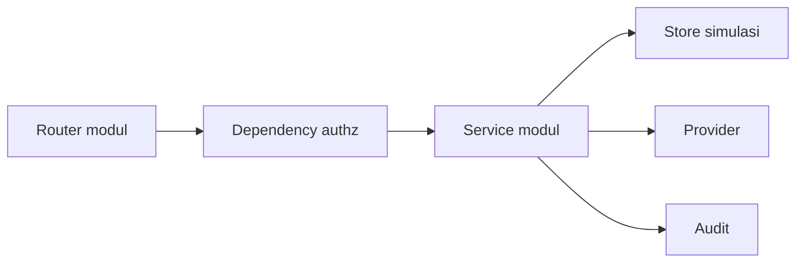

# Developer Handover

**Status:** DRAFT

**Last Updated:** 2026-10-01

## Purpose

Titik awal bagi pengembang yang melanjutkan SUNOVATE: peta repository, organisasi modul, konvensi, aturan kerja, dan cara menambah endpoint.

## Konteks Singkat

- **CONFIRMED**: SUNOVATE adalah SUN Integrated Management and Knowledge Platform untuk Direktorat Surat Utang Negara, DJPPR, Kementerian Keuangan RI (sumber: brief sesi 2026-10-01).
- **CONFIRMED**: Arsitektur modular monolith: Next.js App Router (TypeScript strict, Tailwind) dan FastAPI (Pydantic v2, SQLAlchemy 2, Alembic) dengan PostgreSQL + pgvector + full-text search (sumber: brief sesi 2026-10-01, ADR-001, ADR-002, ADR-003).
- **CONFIRMED**: SUNOVATE bukan SUN Job Monitor; file tetap berupa referensi eksternal; Hermes tidak pernah mengakses database secara langsung (sumber: AGENTS.md, ADR-004).
- **CONFIRMED**: Runtime scaffold memakai store simulasi in-memory (`DATA_BACKEND=simulated`); repository SQLAlchemy belum ada (sumber: ADR-007). Baca [known-limitations.md](known-limitations.md) sebelum mulai.

## Peta Repository

| Path | Isi |
|---|---|
| `apps/web` | Aplikasi Next.js; route di `src/app`, unit test `src/**/*.test.tsx`, e2e di `e2e/` |
| `apps/api` | Aplikasi FastAPI; paket `sunovate_api`, Alembic, test di `tests/`, environment Python dikelola uv |
| `packages/contracts` | Tipe API dan schema Zod yang dipakai web |
| `packages/shared-types` | Enum bersama |
| `packages/config` | Basis `tsconfig` |
| `packages/ui` | Paket komponen UI |
| `database/` | Migration, seed, dan README database |
| `infrastructure/` | Docker dan konfigurasi lokal |
| `scripts/` | Skrip setup, development, dan validation |
| `tests/` | Suite Python lintas modul: `integration`, `security`, `rag-evaluation`, `fixtures` |
| `references/` | Referensi sumber; file biner sumber tidak di-commit (ADR-014) |
| `docs/` | Dokumentasi; `docs/_archive/` berisi dokumen lama yang diarsipkan (ADR-012) |

## Organisasi Backend

| Lapisan | Lokasi di `sunovate_api` | Tanggung jawab |
|---|---|---|
| core | `core` | Konfigurasi, log JSON dengan `request_id`, error, envelope respons |
| db | `db` | Model SQLAlchemy dan session |
| authz | `authz` | Principal, `AuthorizationService`, dependency FastAPI |
| providers | `providers` | Interface provider, implementasi development, placeholder produksi nonaktif |
| store | `store` | Store simulasi in-memory dan dataset SIMULATED |
| modules | `modules` | health, auth, identity, knowledge, documents, search, work, pending, audit, approvals, hermes, providers |

- **PROPOSED**: Saat repository SQLAlchemy dibuat, service tetap memakai antarmuka yang sama dan hanya sumber data yang berganti; lihat [future-development.md](future-development.md).

## Mulai dari Mana

1. Jalankan aplikasi mengikuti [local-development.md](../11-operations/local-development.md).
2. Baca `AGENTS.md`, [architecture-decisions.md](../03-architecture/architecture-decisions.md), dan [permission-matrix.md](../06-security/permission-matrix.md).
3. Buka `http://localhost:8000/docs` dan coba endpoint dengan pengguna simulasi.
4. Telusuri satu alur penuh: `POST /api/v1/knowledge` lalu `POST /api/v1/knowledge/{id}/submit`.
5. Telusuri pipeline Hermes di modul `hermes` (lihat [hermes-overview.md](../05-ai-rag/hermes-overview.md)).

## Aturan Kerja dari AGENTS.md

- Gunakan `SIMULATED_DATA` untuk semua record demonstrasi; jangan menambah data internal atau data keuangan asli.
- Blueprint NestJS/Prisma lama berstatus PROPOSED historis; scaffold memakai FastAPI/SQLAlchemy.
- Integrasi identitas, dokumen, notifikasi, AI, dan integrasi eksternal lain tetap nonaktif sampai divalidasi.
- Otorisasi ditegakkan di API: permission, team scope, dan klasifikasi data.
- TypeScript strict, Python bertipe, server component secara default, perubahan minimal.
- Tidak menambah Turbo, Kubernetes, Redis, message broker, atau dependensi baru tanpa kebutuhan konkret.
- Hanya token desain SUNOVATE yang terkunci; tanpa gradient, ungu, ikon Unicode, atau grid kartu besar generik.
- Fungsi SUN Tematik adalah OPEN QUESTION; jangan mengarang perilaku.
- Sebelum handoff, jalankan lint, typecheck, test, dan build yang relevan, lalu laporkan hasil aktual.
- Jangan mengubah `docs/` atau dokumen sumber di root tanpa permintaan eksplisit.

## Konvensi

- **CONFIRMED**: Prefix API `/api/v1`; envelope `{ "data", "meta" }` dengan `meta.dataLabel`; error `{ "code", "message", "details", "requestId" }`; header `X-Request-ID`; pagination `page` dan `pageSize` (1–100, default 20) (sumber: implementasi scaffold sesi 2026-10-01).
- **CONFIRMED**: Kode permission berformat `resource:action` (sumber: fact sheet bagian 5).
- **CONFIRMED**: Record yang tidak boleh dibaca mengembalikan 404, bukan 403 (sumber: implementasi scaffold sesi 2026-10-01).
- **CONFIRMED**: Update memakai `revision`; revision usang menghasilkan 409 `REVISION_CONFLICT` (sumber: ADR-011).
- **PROPOSED**: Deadline state hanya dihitung backend; frontend menampilkan nilainya.

## Menambah Endpoint

1. Tentukan permission. Pakai kode yang ada; bila perlu kode baru, tambahkan ke data permission, matriks role, dan [permission-matrix.md](../06-security/permission-matrix.md) pada perubahan yang sama.
2. Tulis schema request dan respons dengan Pydantic v2, bertipe penuh.
3. Tulis logika di service modul. Terapkan permission, team scope, dan klasifikasi lewat `AuthorizationService`; filter sebelum pagination agar `meta.total` tidak membocorkan record.
4. Daftarkan route di router modul dengan dependency authz. Tidak ada endpoint terlindungi tanpa dependency ini.
5. Catat audit untuk aksi tulis dan penolakan akses.
6. Tambahkan test di `apps/api/tests/`: kasus berhasil, 401, 403, 404 untuk record terlarang, dan 409 bila memakai `revision`.
7. Perbarui `packages/contracts` bila web memakai endpoint tersebut.
8. Perbarui [endpoint-catalog.md](../07-api/endpoint-catalog.md) dan CHANGELOG.md.
9. Jalankan `pnpm api:lint`, `pnpm api:typecheck`, `pnpm api:test`, lalu `pnpm validate` bila web ikut berubah.

## Related Documents

- [administrator-guide.md](administrator-guide.md)
- [known-limitations.md](known-limitations.md)
- [future-development.md](future-development.md)
- [component-architecture.md](../03-architecture/component-architecture.md)
- [backend-testing.md](../10-testing/backend-testing.md)
