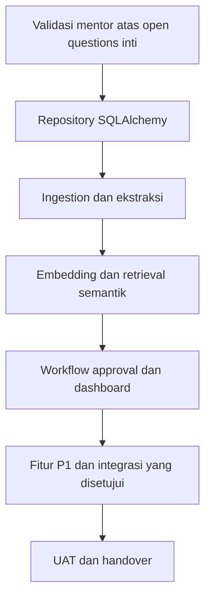

# Pengembangan Lanjutan

**Status:** PROPOSED

**Last Updated:** 2026-10-11

## Purpose

Mengurutkan langkah pengembangan berikutnya sesuai roadmap enam bulan dan open questions, sehingga pengembang dan mentor memiliki urutan kerja yang sama.

## Dasar

- **CONFIRMED**: Periode pengembangan 21 September 2026 sampai 20 Maret 2027 (sumber: brief sesi 2026-10-01).
- **PROPOSED**: Roadmap: Bulan 1 Requirement; Bulan 2 Foundation; Bulan 3 AI & Data; Bulan 4 Web; Bulan 5 Integrasi; Bulan 6 Implementasi. Target feature-complete akhir Bulan 5 (sumber: Proposal v2.4, slide 21).
- **PROPOSED**: Prioritas P0 MVP, P1, dan P2 mengikuti Proposal v2.4, slide 11. P2 hanya setelah validasi dan bukan janji.

## Urutan Langkah

| No | Langkah | Bulan roadmap | Bergantung pada | Status |
|---|---|---|---|---|
| 1 | Validasi mentor: pengakuan atas jawaban knowledge owner (OQ-24) dan sisa pertanyaan (nama tim resmi, skema klasifikasi, mekanisme login, persyaratan server, pemetaan peran, alur publikasi, model AI). Pilot ("6 tim"), hosting (komputer tersendiri sebagai server), dan knowledge owner/reviewer (ketua tim dan PIC) sudah dijawab knowledge owner | Bulan 1–2 | OQ-02, OQ-05, OQ-07, OQ-11, OQ-12, OQ-23, OQ-24, OQ-25 | PROPOSED |
| 2 | Implementasi repository SQLAlchemy untuk semua modul, dengan antarmuka service yang sama, lalu jalankan ulang test API terhadap PostgreSQL | Bulan 2 | Skema `0001_initial_schema` | PROPOSED, diimplementasikan 2026-10-02 (ADR-015: `DATA_BACKEND=postgres`, revisi `0002_ordering_columns`, `pnpm db:test`); review disetujui dan digabung ke main |
| 3 | Validasi jalur Docker Compose di mesin yang memiliki Docker | Bulan 2 | Izin perangkat | PROPOSED |
| 4 | Pipeline ingestion: registrasi file dari provider yang disetujui, ekstraksi, chunking, status `extraction_status`, karantina | Bulan 3 | OQ-04, OQ-06 | PROPOSED |
| 5 | Embedding dan retrieval semantik dengan model yang disetujui; tetapkan tipe dimensi kolom vektor dan indeks ANN lewat migration baru | Bulan 3 | OQ-11 | PROPOSED |
| 6 | Provider AI yang disetujui di balik HermesGateway, dengan evaluasi ulang golden set dan gate kebocoran | Bulan 3 | OQ-11 | PROPOSED |
| 7 | Eksekusi aksi setelah approval disetujui, dengan audit dan separation of duties | Bulan 4 | OQ-12 | PROPOSED |
| 8 | Dashboard dan reporting sesuai indikator yang dibutuhkan; ekspor | Bulan 4 | OQ-10, OQ-15 | PROPOSED |
| 9 | Fitur P1: relasi antarperaturan, knowledge capture SME, Close Out Note dan playbook, notifikasi dalam aplikasi | Bulan 4–5 | OQ-09, OQ-17 | PROPOSED |
| 10 | Document automation berbasis template yang disetujui | Bulan 5 | OQ-16 | PROPOSED |
| 11 | Integrasi yang disetujui saja, melalui checklist kesiapan integrasi | Bulan 5 | OQ-06, OQ-07, OQ-08 | PROPOSED |
| 12 | Audit aksesibilitas, security test, UAT, bug fixing, dokumentasi, handover | Bulan 6 | OQ-20 | PROPOSED |
| 13 | Paket demo sekitar 25 pengguna pada komputer kantor: Compose, Nginx, backup/restore, load test; tunnel hanya setelah approval | Demo/UAT | OQ-20, OQ-23, OQ-34 | NEEDS APPROVAL |

## Item Tertunda dari Jawaban Knowledge Owner (2026-10-02)

Semua item di bawah berstatus **PROPOSED** dan belum diimplementasikan. Sumber: deck `v1_` slide 24 (jawaban knowledge owner); pengakuan mentor tertunda (OQ-24).

| No | Item | Bergantung pada | Status |
|---|---|---|---|
| PD-1 | Batasi hak ubah/unggah: cabut `knowledge:create`, `knowledge:update`, `knowledge:submit`, dan `document:create` dari role `staff`; perbarui matriks, seed, dan uji otorisasi (termasuk uji 403 untuk `staff`). Perubahan kode pada cabang terpisah dan sesuai [permission-matrix](../06-security/permission-matrix.md). | OQ-05, OQ-24, OQ-25 (konfirmasi role ketua tim, kasubdit PMP, Kasi MP, PIC) | PROPOSED, belum diimplementasikan |
| PD-2 | Rancang deployment server khusus (satu komputer): host, jaringan, OS, backup, patching, TLS, administrator. | OQ-07, OQ-23 | PROPOSED |
| PD-3 | Tentukan mekanisme login untuk pilot di server khusus; `POST /auth/dev/login` tetap nonaktif di luar development. | OQ-07, OQ-23 | PROPOSED |
| PD-4 | Klarifikasi "Sandbox server" sebelum memilih document provider pilot. | OQ-06, OQ-22 | PROPOSED |
| PD-5 | Definisikan indikator "yield" dan "kepemilikan SBN" setelah sumber data otoritatif dan siapa yang boleh melihatnya diketahui; tidak ada tabel bisnis SUN (ADR-013) sebelum itu. | OQ-10, OQ-21 | PROPOSED |
| PD-6 | Aturan untuk Telegram dan WhatsApp bila dilanjutkan (P2): kajian keamanan, konten RESTRICTED ke atas tidak dikirim ke kanal eksternal secara default. | OQ-08 | PROPOSED |
| PD-7 | Implementasi Draft Workspace file pekerjaan: model lampiran/versi/grant, provider upload, malware scan, lifecycle DRAFT sampai WITHDRAWN, publikasi immutable, API, UI, audit, dan test AC-26 sampai AC-31. Spesifikasi tersedia di `work-file-draft-workspace.md`. | OQ-35, OQ-06, OQ-12, OQ-25 | NEEDS APPROVAL; desain teknis selesai 2026-10-11, kode belum dimulai |

## Backlog Persistence PostgreSQL

**PROPOSED** (dari ADR-015; tidak dikerjakan pada perubahan persistence):

| Butir | Alasan ditunda | Rujukan |
|---|---|---|
| Validasi `DATABASE_URL` secara lazy pada `session()` pertama `PostgresBackend` | Mengubah perilaku fail-fast saat startup; untuk sekarang dimitigasi dengan dokumentasi | KL-24 |
| Mengakhiri transaksi baca (`repo.end_read()`) sebelum `HermesClient.answer` | Generasi saat ini lokal; dipertimbangkan bersama provider AI remote (OUT OF SCOPE saat ini) | KL-23 |
| Engine kecil terpisah untuk `audit_denial` | Mitigasi risiko pool koneksi kedua; tidak realistis pada skala `SIMULATED_DATA` | KL-22 |
| Menutup celah `TRUNCATE` pada trigger append-only | OUT OF SCOPE requirements persistence | KL-21 |
| Perluasan FTS `search_vector` dari endpoint pencarian ke retrieval SAVI | FTS endpoint sudah aktif; konfigurasi `simple` perlu diuji agar tidak menurunkan recall golden set SAVI | [retrieval-strategy.md](../05-ai-rag/retrieval-strategy.md) |

## Kandidat yang Ditunda

- **OUT OF SCOPE** sampai divalidasi: SharePoint production sync, SSO organisasi, Power BI, Telegram dan WhatsApp, market data resmi, integrasi Kemenkeu Satu (sumber: Proposal v2.4, slide 11, prioritas P2). Knowledge owner menjawab "bisa" untuk Telegram dan WhatsApp (OQ-08) dan "Sandbox server" untuk peran SharePoint (OQ-06, perlu klarifikasi); keduanya belum menjadi integrasi yang tersedia.
- **OPEN QUESTION**: Fitur SUN Business (instrumen, lelang, transaksi) tidak direncanakan sampai cakupannya divalidasi (ADR-013).
- **OPEN QUESTION**: Fitur untuk SUN Tematik menunggu OQ-01.
- **OPEN QUESTION**: Penggunaan ulang pola dari SUN Job Monitor menunggu OQ-19.
- **DEFERRED**: Go untuk gateway/webhook/notifikasi/worker konkuren. Ekstraksi service memerlukan metrik bottleneck, ADR, owner operasi, dan test kontrak.
- **DEFERRED**: Rust untuk parsing/validasi file, checksum, redaction, atau komponen keamanan berisiko tinggi setelah threat review.
- **DEFERRED**: PWA, Android, dan iOS setelah kontrak API, autentikasi, dan kebijakan perangkat stabil. Opsi Flutter tidak diputuskan.
- **PROPOSED FUTURE**: Hosting produksi private cloud/Azure/internal data center/hybrid diputuskan instansi; komputer kantor hanya demo sementara.

## Aturan Saat Melanjutkan

- **PROPOSED**: Setiap langkah dimulai dengan validasi kebutuhan; tidak menambah teknologi atau dependensi tanpa kebutuhan konkret (sumber: AGENTS.md).
- **PROPOSED**: Setiap langkah yang menyentuh otorisasi, retrieval, atau Hermes menambah test negatif dan kasus golden set.
- **PROPOSED**: Keputusan arsitektur baru dicatat di [architecture-decisions.md](../03-architecture/architecture-decisions.md) dan [decision-log.md](../12-governance/decision-log.md).

## Risks

- R-06 Scope melebihi periode enam bulan; urutan di atas memprioritaskan P0 MVP.
- R-08 Ketergantungan pada satu pengembang; dokumentasi handover diperbarui setiap langkah.

## Related Documents

- [product-roadmap.md](../01-product/product-roadmap.md)
- [known-limitations.md](known-limitations.md)
- [open-questions.md](../00-project/open-questions.md)
- [mvp-scope.md](../01-product/mvp-scope.md)
- [task-tracker.md](task-tracker.md)
