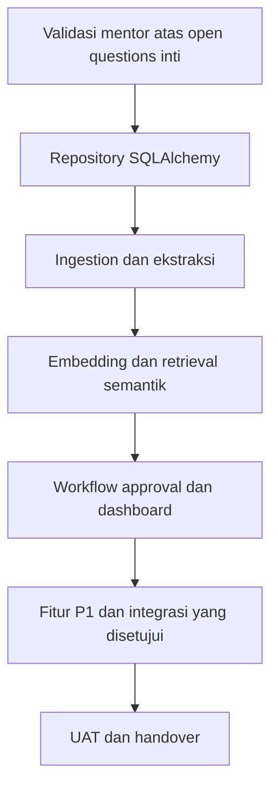

# Pengembangan Lanjutan

**Status:** PROPOSED

**Last Updated:** 2026-10-02

## Purpose

Mengurutkan langkah pengembangan berikutnya sesuai roadmap enam bulan dan open questions, sehingga pengembang dan mentor memiliki urutan kerja yang sama.

## Dasar

- **CONFIRMED**: Periode pengembangan 21 September 2026 sampai 20 Maret 2027 (sumber: brief sesi 2026-10-01).
- **PROPOSED**: Roadmap: Bulan 1 Requirement; Bulan 2 Foundation; Bulan 3 AI & Data; Bulan 4 Web; Bulan 5 Integrasi; Bulan 6 Implementasi. Target feature-complete akhir Bulan 5 (sumber: Proposal v2.4, slide 21).
- **PROPOSED**: Prioritas P0 MVP, P1, dan P2 mengikuti Proposal v2.4, slide 11. P2 hanya setelah validasi dan bukan janji.

## Urutan Langkah

| No | Langkah | Bulan roadmap | Bergantung pada | Status |
|---|---|---|---|---|
| 1 | Validasi mentor: pilot, dokumen yang boleh masuk, klasifikasi, login dan hosting, knowledge owner dan reviewer, alur publikasi, model AI | Bulan 1–2 | OQ-03, OQ-04, OQ-05, OQ-07, OQ-09, OQ-11, OQ-12 | PROPOSED |
| 2 | Implementasi repository SQLAlchemy untuk semua modul, dengan antarmuka service yang sama, lalu jalankan ulang test API terhadap PostgreSQL | Bulan 2 | Skema `0001_initial_schema` | PROPOSED, diimplementasikan 2026-10-02 (ADR-015: `DATA_BACKEND=postgres`, revisi `0002_ordering_columns`, `pnpm db:test`); menunggu review dan persetujuan |
| 3 | Validasi jalur Docker Compose di mesin yang memiliki Docker | Bulan 2 | Izin perangkat | PROPOSED |
| 4 | Pipeline ingestion: registrasi file dari provider yang disetujui, ekstraksi, chunking, status `extraction_status`, karantina | Bulan 3 | OQ-04, OQ-06 | PROPOSED |
| 5 | Embedding dan retrieval semantik dengan model yang disetujui; tetapkan tipe dimensi kolom vektor dan indeks ANN lewat migration baru | Bulan 3 | OQ-11 | PROPOSED |
| 6 | Provider AI yang disetujui di balik HermesGateway, dengan evaluasi ulang golden set dan gate kebocoran | Bulan 3 | OQ-11 | PROPOSED |
| 7 | Eksekusi aksi setelah approval disetujui, dengan audit dan separation of duties | Bulan 4 | OQ-12 | PROPOSED |
| 8 | Dashboard dan reporting sesuai indikator yang dibutuhkan; ekspor | Bulan 4 | OQ-10, OQ-15 | PROPOSED |
| 9 | Fitur P1: relasi antarperaturan, knowledge capture SME, Close Out Note dan playbook, notifikasi dalam aplikasi | Bulan 4–5 | OQ-09, OQ-17 | PROPOSED |
| 10 | Document automation berbasis template yang disetujui | Bulan 5 | OQ-16 | PROPOSED |
| 11 | Integrasi yang disetujui saja, melalui checklist kesiapan integrasi | Bulan 5 | OQ-06, OQ-07, OQ-08 | PROPOSED |
| 12 | Audit aksesibilitas, security test, UAT, bug fixing, dokumentasi, handover | Bulan 6 | OQ-20 | PROPOSED |

## Backlog Persistence PostgreSQL

**PROPOSED** (dari ADR-015; tidak dikerjakan pada perubahan persistence):

| Butir | Alasan ditunda | Rujukan |
|---|---|---|
| Validasi `DATABASE_URL` secara lazy pada `session()` pertama `PostgresBackend` | Mengubah perilaku fail-fast saat startup; untuk sekarang dimitigasi dengan dokumentasi | KL-24 |
| Mengakhiri transaksi baca (`repo.end_read()`) sebelum `HermesClient.answer` | Generasi saat ini lokal; dipertimbangkan bersama provider AI remote (OUT OF SCOPE saat ini) | KL-23 |
| Engine kecil terpisah untuk `audit_denial` | Mitigasi risiko pool koneksi kedua; tidak realistis pada skala `SIMULATED_DATA` | KL-22 |
| Menutup celah `TRUNCATE` pada trigger append-only | OUT OF SCOPE requirements persistence | KL-21 |
| Prefilter FTS `search_vector` untuk search dan retrieval | Konfigurasi `simple` tanpa stemming dapat menurunkan recall dibanding pencarian leksikal saat ini | [retrieval-strategy.md](../05-ai-rag/retrieval-strategy.md) |

## Kandidat yang Ditunda

- **OUT OF SCOPE** sampai divalidasi: SharePoint production sync, SSO organisasi, Power BI, Telegram dan WhatsApp, market data resmi, integrasi Kemenkeu Satu (sumber: Proposal v2.4, slide 11, prioritas P2).
- **OPEN QUESTION**: Fitur SUN Business (instrumen, lelang, transaksi) tidak direncanakan sampai cakupannya divalidasi (ADR-013).
- **OPEN QUESTION**: Fitur untuk SUN Tematik menunggu OQ-01.
- **OPEN QUESTION**: Penggunaan ulang pola dari SUN Job Monitor menunggu OQ-19.

## Aturan Saat Melanjutkan

- **PROPOSED**: Setiap langkah dimulai dengan validasi kebutuhan; tidak menambah teknologi atau dependensi tanpa kebutuhan konkret (sumber: AGENTS.md).
- **PROPOSED**: Setiap langkah yang menyentuh otorisasi, retrieval, atau Hermes menambah test negatif dan kasus golden set.
- **PROPOSED**: Keputusan arsitektur baru dicatat di [architecture-decisions.md](../03-architecture/architecture-decisions.md) dan [decision-log.md](../12-governance/decision-log.md).

## Risks

- R-06 Scope melebihi periode enam bulan; urutan di atas memprioritaskan P0 MVP.
- R-08 Ketergantungan pada satu pengembang; dokumentasi handover diperbarui setiap langkah.

## Related Documents

- [product-roadmap.md](../01-product/product-roadmap.md)
- [known-limitations.md](known-limitations.md)
- [open-questions.md](../00-project/open-questions.md)
- [mvp-scope.md](../01-product/mvp-scope.md)
