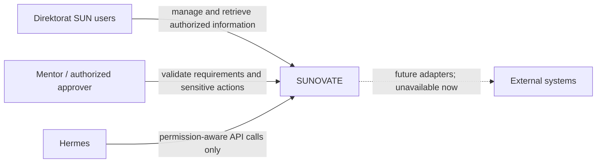
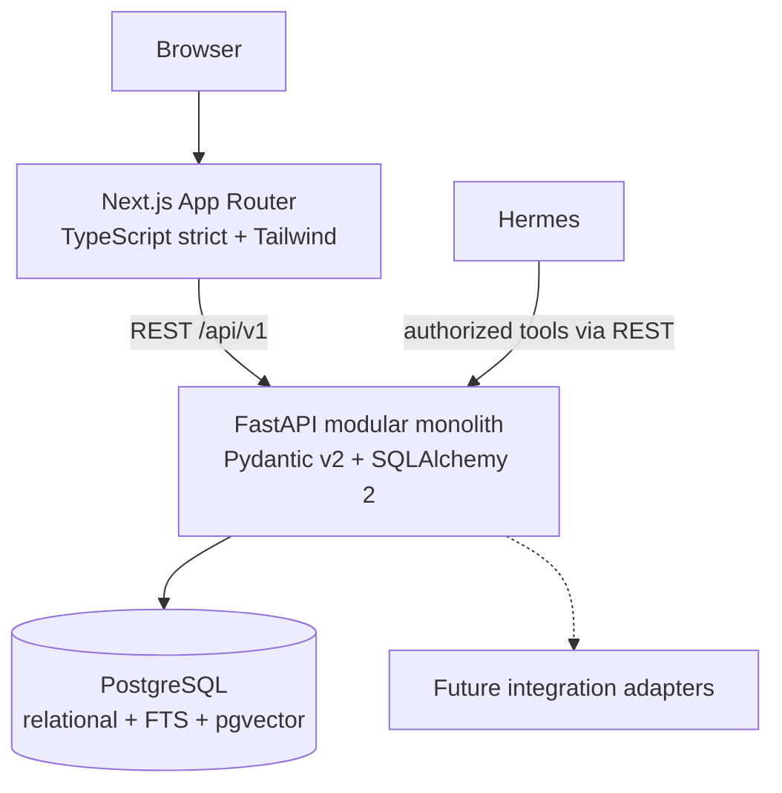

# Architecture

**Status:** PROPOSED  
**Last Updated:** 2026-10-01

## Principles

- **CONFIRMED:** deploy and evolve SUNOVATE as a modular monolith.
- **CONFIRMED:** use Next.js App Router with strict TypeScript and Tailwind CSS.
- **CONFIRMED:** expose application capabilities through FastAPI using Pydantic v2, SQLAlchemy 2, and Alembic.
- **CONFIRMED:** use PostgreSQL with full-text search and pgvector.
- **CONFIRMED:** all authorization decisions are enforced by the API; UI controls are not a security boundary.
- **CONFIRMED:** Hermes is an API consumer and never a direct database client.
- **PROPOSED:** keep domain modules internally separated while sharing one deployable API and one database.

## System context

`External systems` covers production SSO, SharePoint, Power BI, Telegram, WhatsApp, Kemenkeu Satu, BI, and market-data sources. Their dotted connection is **PROPOSED**, not implemented.

## Container view

## Module boundaries

**PROPOSED:** `auth`, `users`, `teams`, `management_cockpit`, `work_management`, `meetings`, `inspections`, `knowledge`, `documents`, `sun_business`, `reporting`, `notifications`, `integrations`, `audit`, `ai`, and `health`.

Modules may reference shared identity and audit capabilities but should not bypass application services to mutate another module's records. Microservices, queues, and extra infrastructure are **OUT OF SCOPE** until measured needs justify them.

## Source-of-truth boundaries

- PostgreSQL: structured SUNOVATE records, permissions, metadata, audit events, search text, and embeddings.
- External document repository: **PROPOSED** future source for official files; no production connection exists.
- Search vectors and FTS indexes: derived retrieval data, not independent business records.
- Hermes: orchestration only, never a source of truth.

## Related Documents

- [Data architecture](../04-data/README.md)
- [Knowledge architecture](../05-knowledge/README.md)
- [Security architecture](../06-security/README.md)
- [Deployment](../09-delivery/README.md)
