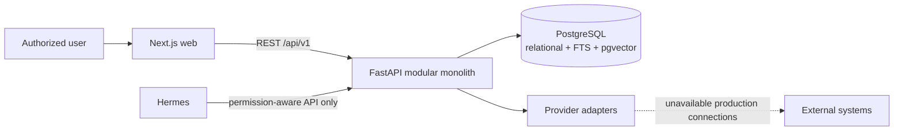

# Container Architecture

**Status:** PROPOSED  
**Last Updated:** 2026-10-01

## Containers and ownership

- **CONFIRMED:** Next.js App Router, strict TypeScript, and Tailwind own presentation and browser interaction.
- **CONFIRMED:** FastAPI with Pydantic v2 owns validation, authorization enforcement, use cases, and OpenAPI.
- **CONFIRMED:** SQLAlchemy 2 owns persistence mapping; Alembic owns schema migrations.
- **CONFIRMED:** PostgreSQL is the structured source of truth and supplies pgvector plus full-text search.
- **PROPOSED:** deploy web and API independently while retaining one modular application boundary.
- **CONFIRMED:** Hermes never connects to PostgreSQL directly.
- **PROPOSED:** external adapters expose explicit mock/unavailable states until approved access exists.

## Backend modules

Proposed modules are identity and access, teams, work management, meetings, inspections, knowledge, documents, SUN business, reporting, notifications, integrations, audit, AI tools, and health. Module internals may share one database, but cross-module access should go through application services rather than arbitrary table coupling.

## Related Documents

- [Architecture baseline](README.md)
- [API contract](../07-api/README.md)
- [Deployment](../09-delivery/deployment.md)
