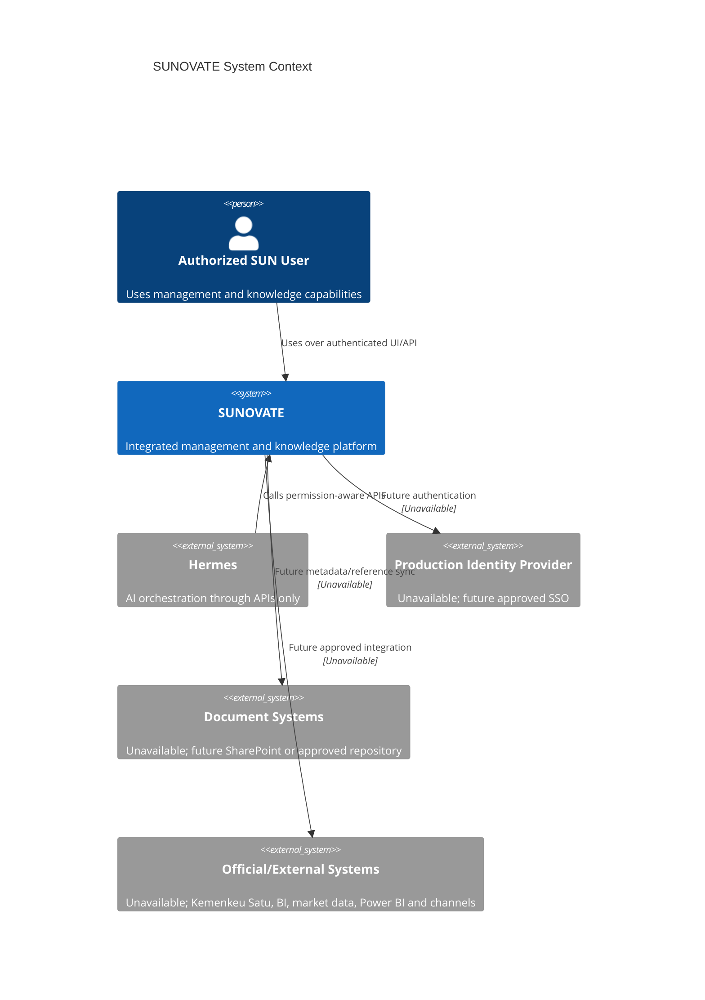

# System Context

**Status:** PROPOSED  
**Last Updated:** 2026-10-01

SUNOVATE sits between authorized users and approved information sources. Dashed nodes are future integration boundaries, not available production services.

## Context rules

- **CONFIRMED:** Hermes has no direct database path.
- **CONFIRMED:** unavailable systems must be represented by adapters/mocks and labeled as such.
- **PROPOSED:** SUNOVATE stores document metadata and references while approved document repositories remain source of truth where applicable.
- **OPEN QUESTION:** authoritative source and update cadence for each SUN business dataset.

## Related Documents

- [Architecture index](README.md)
- [Container architecture](containers.md)
- [Integration boundaries](integration-boundaries.md)
