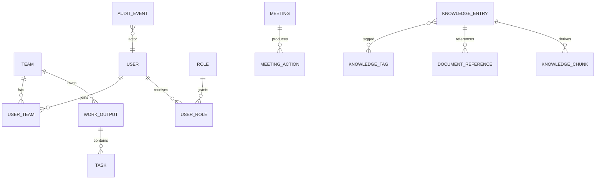

# Data Architecture

**Status:** PROPOSED  
**Last Updated:** 2026-10-01

## Principles

- **CONFIRMED:** PostgreSQL is the structured source of truth for SUNOVATE-owned metadata and operational records.
- **CONFIRMED:** PostgreSQL full-text search and pgvector support retrieval; indexes and embeddings are derived data.
- **CONFIRMED:** SQLAlchemy 2 is the ORM and Alembic owns schema migrations.
- **CONFIRMED:** all repository seed data must be visibly labeled `SIMULATED_DATA`.
- **OUT OF SCOPE:** real internal SUN data, invented SUN figures, or production document synchronization.
- **PROPOSED:** records that can be edited concurrently carry a version field and reject stale writes.

## Entity overview

This is a conceptual map, not an approved physical schema. Approval cardinalities and SUN Business entities remain subject to mentor validation.

## Data classes

- Identity and access: users, roles, permissions, team scope.
- Work management: outputs, tasks, milestones, pending matters, follow-ups.
- Collaboration: meetings, meeting actions, inspections.
- Knowledge: entries, versions, tags, document references, chunks, embeddings.
- Governance: approval requests, audit events, integration runs.

Document binaries should not be stored as PostgreSQL BLOBs. Until an approved repository integration exists, local development uses metadata and simulated references only.

## Migration and seed rules

1. Every schema change receives an Alembic revision.
2. Migrations must be forward-reviewable; destructive changes require an explicit backup/rollback plan.
3. Seed fixtures use synthetic names and content plus `data_origin = SIMULATED_DATA`.
4. Search vectors and embeddings can be rebuilt from approved source metadata/content.

## Related Documents

- [Container architecture](../03-architecture/container-architecture.md)
- [Knowledge lifecycle](../05-knowledge/knowledge-lifecycle.md)
- [API contract](../07-api/README.md)
