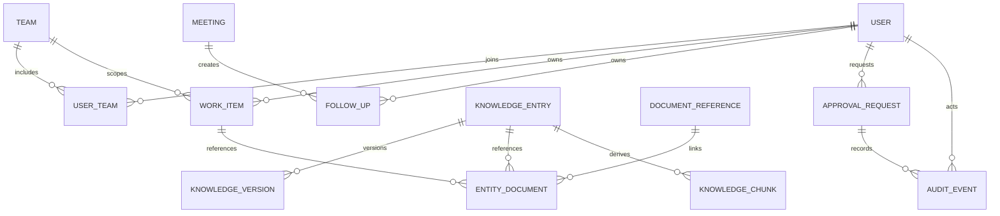

# Entity Relationship Overview

**Status:** PROPOSED  
**Last Updated:** 2026-10-01

This conceptual model avoids unvalidated SUN transaction fields and organizational hierarchy.

## Entity intent

- **CONFIRMED:** teams include PPSUN, AKPSUN, PSUN, PPPSUN, DHTV, and SUN Tematik.
- **PROPOSED:** `USER_TEAM` permits multiple team memberships without encoding job titles.
- **PROPOSED:** `WORK_ITEM` is a neutral foundation until task/output semantics are validated.
- **PROPOSED:** immutable knowledge versions retain provenance and lifecycle history.
- **PROPOSED:** `DOCUMENT_REFERENCE` stores links and metadata, not production file binaries.
- **PROPOSED:** `KNOWLEDGE_CHUNK` is derived retrieval data and can be rebuilt.
- **OPEN QUESTION:** required SUN business entities, fields, and relationships.

## Related Documents

- [Data baseline](README.md)
- [Knowledge lifecycle](../05-knowledge/lifecycle.md)
- [Approval workflow](../06-security/approval-workflow.md)
