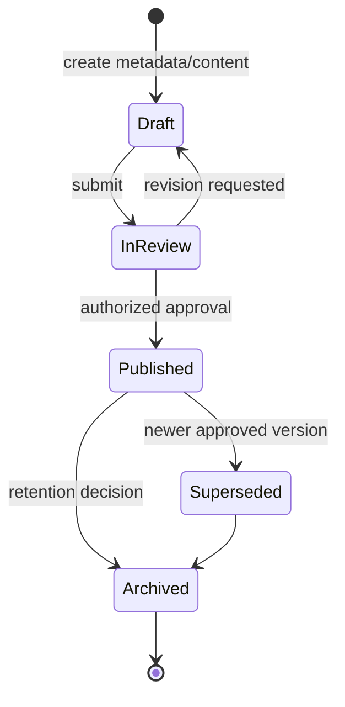

# Knowledge Hub

**Status:** NEEDS MENTOR VALIDATION  
**Last Updated:** 2026-10-01

## Purpose

Knowledge Hub organizes authorized SUN knowledge so users can discover sources, understand context, and reuse validated learning.

## Proposed coverage

- **PROPOSED:** regulations and policies; SUN, financing, market/yield, portfolio/risk, auction/transaction studies; SOP/playbooks; reports; close-out notes; lessons learned; and historical knowledge.
- **PROPOSED:** each entry has metadata, owner, classification, source reference, lifecycle status, and version.
- **CONFIRMED:** PostgreSQL full-text search and pgvector support search and retrieval.
- **CONFIRMED:** generated answers must preserve user permissions; Hermes has no direct database access.
- **OPEN QUESTION:** authoritative repositories, taxonomy, classification levels, approval actors, retention, and document parsing constraints.

## Knowledge lifecycle

All transitions and role names are **PROPOSED** until mentor validation. A rejected review returns to Draft rather than deleting history.

## Quality rules

Answers and search results should expose source, version, and status. Draft or restricted content must not become visible through embeddings or snippets. Derived chunks and embeddings must be replaceable and traceable to their source version.

## Related Documents

- [Ingestion](ingestion.md)
- [RAG](rag.md)
- [Security](../06-security/README.md)
