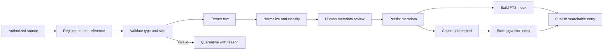

# Knowledge Ingestion

**Status:** PROPOSED  
**Last Updated:** 2026-10-01

## Pipeline

## Controls

- **PROPOSED:** accept only supported formats and enforce configurable size limits.
- **PROPOSED:** calculate a content hash for duplicate detection and provenance.
- **PROPOSED:** remove active content from unsafe formats before extraction.
- **PROPOSED:** retain source URI, version, extraction state, and failure reason.
- **CONFIRMED:** only `SIMULATED_DATA` is ingested during seed/demo operation.
- **OPEN QUESTION:** approved file formats, size limits, OCR requirement, retention, and source ownership.
- **OUT OF SCOPE:** automatic production SharePoint or Kemenkeu Satu ingestion without access and approval.

## Failure behavior

An extraction or embedding failure must not publish partial content as complete. Metadata may remain visible to authorized operators with an explicit failed or quarantined status and a retry path.

## Related Documents

- [Knowledge lifecycle](lifecycle.md)
- [RAG architecture](rag.md)
- [Security](../06-security/README.md)
