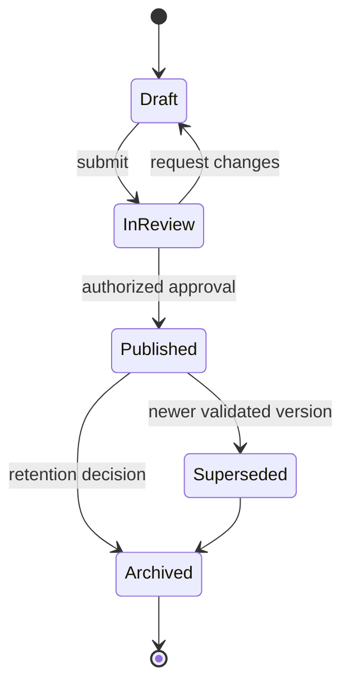

# Knowledge Lifecycle

**Status:** NEEDS MENTOR VALIDATION  
**Last Updated:** 2026-10-01

This lifecycle is **PROPOSED**; it does not assert the institution's current approval flow.

## Controls

- **PROPOSED:** every transition records actor, timestamp, reason, and version.
- **PROPOSED:** only published entries enter default retrieval; drafts require explicit permission and filtering.
- **PROPOSED:** source links, classification, owner, and validity dates are required before publication.
- **OPEN QUESTION:** who can review, approve, supersede, and archive each knowledge category?
- **OPEN QUESTION:** what retention and review periods apply?

## Related Documents

- [Knowledge architecture](README.md)
- [Ingestion](ingestion.md)
- [Approval workflow](../06-security/approval-workflow.md)
