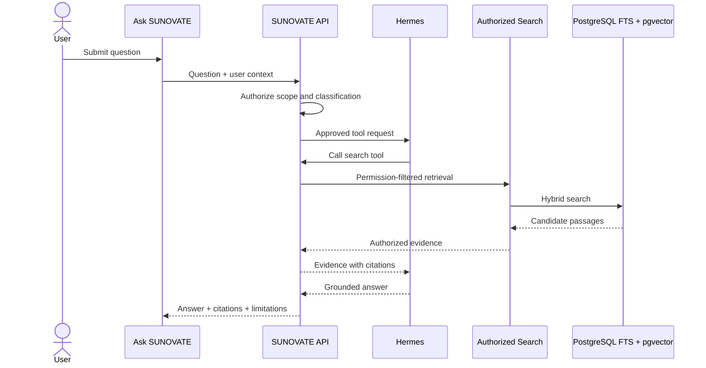

# RAG and Hermes Boundary

**Status:** PROPOSED  
**Last Updated:** 2026-10-01

## Retrieval flow

## Guardrails

- **CONFIRMED:** Hermes has no direct database credentials or query path.
- **PROPOSED:** combine PostgreSQL FTS and pgvector ranking after permission filtering.
- **PROPOSED:** answers cite accessible source entries and state when evidence is insufficient.
- **PROPOSED:** retrieval and tool calls emit audit events without logging unnecessary sensitive content.
- **PROPOSED:** resist prompt injection by treating retrieved content as evidence, never system instructions.
- **OPEN QUESTION:** approved embedding/model provider, hosting boundary, retention, and evaluation thresholds.
- **OUT OF SCOPE:** autonomous consequential writes and access beyond the caller's permissions.

## Related Documents

- [Knowledge Hub](README.md)
- [Authorization](../06-security/authorization.md)
- [API contract](../07-api/README.md)
