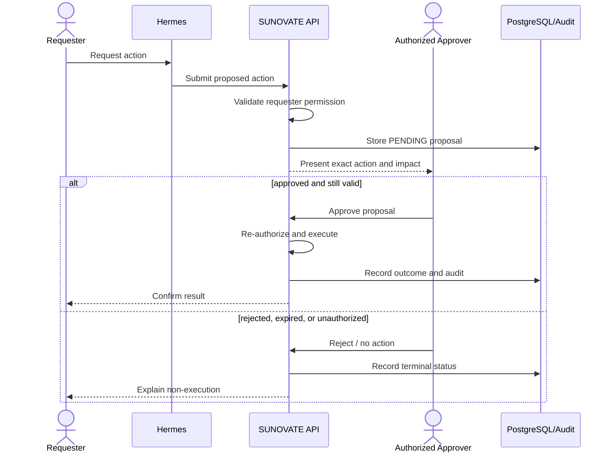

# Sensitive Action Approval

**Status:** NEEDS MENTOR VALIDATION  
**Last Updated:** 2026-10-01

## Baseline

- **CONFIRMED:** Hermes cannot execute a sensitive write without human approval.
- **CONFIRMED:** execution occurs through a permission-aware API and produces an audit event.
- **PROPOSED:** approvals expire and bind to an immutable action payload/hash.
- **OPEN QUESTION:** which actions are sensitive, who may approve each action, and whether self-approval is forbidden.

Approval must not rely on chat text alone. The UI must show the target, proposed mutation, relevant classification, and expected effect. Any changed payload creates a new proposal.

## Related Documents

- [Security baseline](README.md)
- [API contract](../07-api/README.md)
- [Open questions](../11-governance/open-questions-mentor.md)
