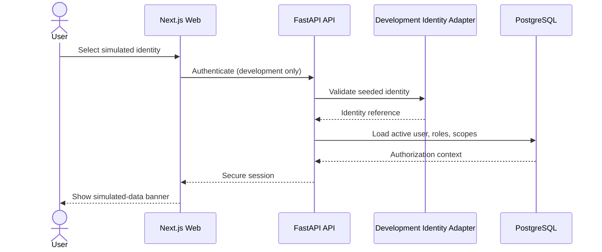

# Authentication Flow

**Status:** NEEDS MENTOR VALIDATION  
**Last Updated:** 2026-10-01

## Development baseline

- **CONFIRMED:** production SSO is unavailable.
- **PROPOSED:** development authentication uses seeded `SIMULATED_DATA` identities and an explicitly visible development-mode marker.
- **PROPOSED:** the API creates or validates the local session and loads roles/scopes on every protected request.
- **OUT OF SCOPE:** presenting development authentication as production identity assurance.

## Production gate

The production identity provider, claims mapping, session lifetime, MFA, account provisioning, deprovisioning, and emergency access are **OPEN QUESTION**. No SSO implementation should be labeled production-ready before these are approved and tested.

## Related Documents

- [Security baseline](README.md)
- [Open questions](../11-governance/open-questions.md)
- [Acceptance](../12-validation/acceptance.md)
