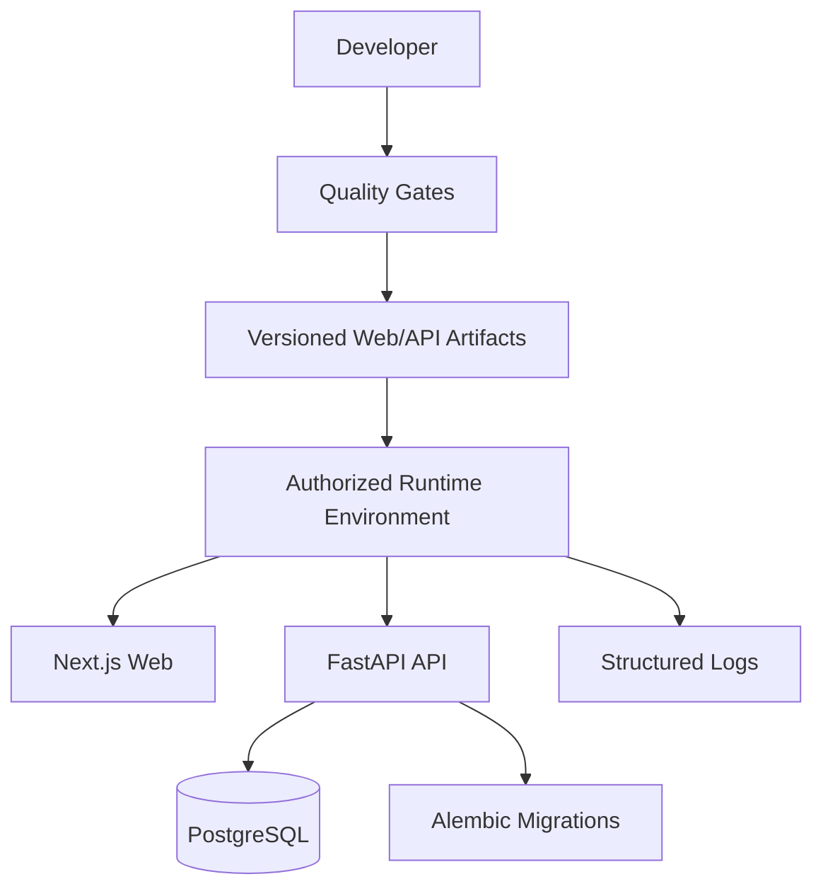

# Deployment

**Status:** PROPOSED  
**Last Updated:** 2026-10-01

## Target-neutral topology

- **PROPOSED:** build immutable, versioned web/API artifacts after lint, type, test, and migration checks pass.
- **PROPOSED:** apply Alembic migrations as an explicit deployment step; back up production data before destructive migrations.
- **PROPOSED:** secrets are injected by the approved environment and never committed.
- **PROPOSED:** rollback redeploys the previous compatible artifacts; database rollback depends on a tested migration plan.
- **OPEN QUESTION:** hosting platform, network zones, domain, TLS termination, backup policy, and release approvers.
- **OUT OF SCOPE:** asserting cloud/on-premise topology or production readiness before infrastructure approval.

## Environment policy

Local development uses simulated records and mock providers. A staging environment should resemble the approved runtime without copying sensitive production data. Production deployment requires security review, restore testing, monitoring ownership, and mentor/stakeholder acceptance.

## Related Documents

- [Delivery plan](README.md)
- [Operations](../10-operations/README.md)
- [Risks](../11-governance/risk-register.md)
